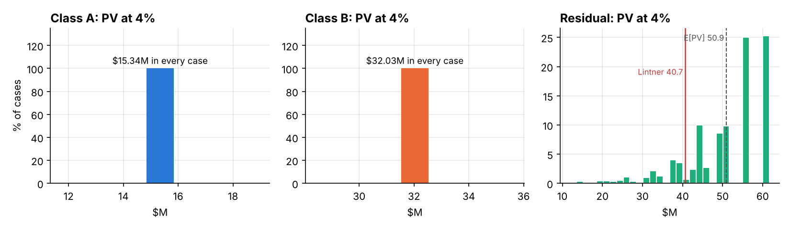
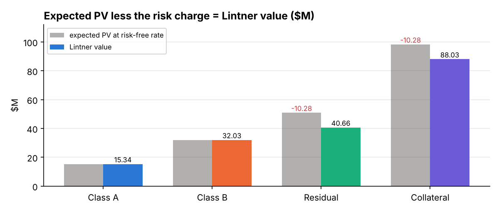
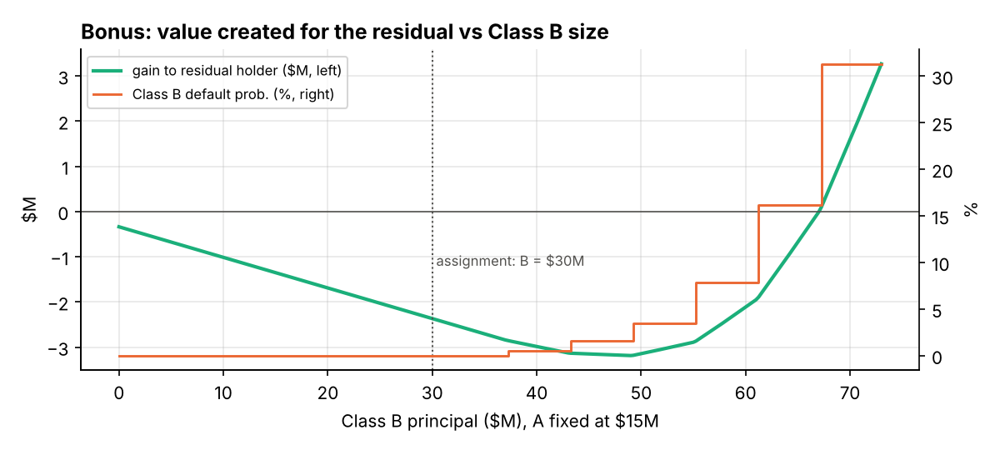

# Project 4 — CDO Valuation with the Lintner Model (Part 2)

[Read the paper (PDF)](paper/cdo_valuation_paper.pdf) · [Model code](cdo_valuation.py) · [Excel workbook](CDO_Part2_Lintner_Valuation.xlsx)

Arnav Srivastava, Harsh Raj

## Assignment context

Part 2 of Mini-Project 3 values the simplified CDO from [Part 1](../03-cdo-simulation/README.md) with the Lintner (certainty-equivalent CAPM) method. The suggested structure is Class A $15 MM at 4.5%, Class B $30 MM at 5.5%, the residual kept by the bank, and a 4% risk-free rate. The steps are:

1. Find the scheduled (no-default) cash flows to each class.
2. Simulate the classes over the same 1,000 fixed cases used in Part 1.
3. Compute each class's present value per case, the covariance matrix, and a default indicator for each note.
4. Back out the market's implicit cost of risk from the collateral's price.
5. Value each class by the Lintner method.

The bonus asks for the Class B size that creates the most value for the bank. No lecture files are included.

## Deal structure

| | Collateral (each of 10 bonds) | Class A | Class B | Residual |
| --- | --- | --- | --- | --- |
| Face / notional | $10 MM | $15 MM | $30 MM | What is left |
| Coupon (annual, paid quarterly) | 6% | 4.5% | 5.5% | Residual |
| Principal | Quarter 20 | Quarter 20 | Quarter 20 | Residual |
| Priority | — | 1st | 2nd | 3rd |

Carried over from Part 1: 4% annual default probability, 60% LGD under the BIS defaultable bond model, correlation 0.20 applied to the normals, and the same 1,000 moment-matched cases (seed 61032026). The collateral is priced at a 9% yield. Both the 9% yield and the 4% risk-free rate are compounded quarterly.

## Methodology

1. **Present values.** Each class's quarterly cash in each case is discounted at the risk-free rate: `PV = Σ X_k / (1 + 0.04/4)^k`. The pool is the sum of the three classes.
2. **The market is the collateral pool.** The CDO holds only the ten bonds, so the pool plays the role of the market portfolio. Its price is observed (the bonds at 9%) and its cash flows are simulated.
3. **Price of risk.** `λ = (E[PV_M] − P_M) / Var(PV_M)`: the gap between the pool's expected PV at 4% and its market price, per unit of variance.
4. **Lintner value.** `V_i = E[PV_i] − λ · Cov(PV_i, PV_M)`. Because the classes add up to the pool, their values add up to the collateral price exactly.
5. **Default indicator.** A note is in default in a case if it is paid less than promised in any quarter.

The script stops with an error if any check fails. The class values must add to the collateral price and every dollar of pool cash must be allocated. λ recovered bond by bond must agree with the pool's λ. A zero default probability must give a zero covariance matrix, and a class that is never short must be valued at its promised cash discounted at 4%.

## Results (USD millions)

| | Class A | Class B | Residual | Total |
| --- | ---: | ---: | ---: | ---: |
| Notional / bank's investment* | 15.00 | 30.00 | 43.03 | 88.03 |
| Expected PV at 4% | 15.34 | 32.03 | 50.94 | 98.30 |
| Cov(PV, pool) | 0.00 | 0.00 | 98.80 | 98.80 |
| Risk charge λ·Cov | 0.00 | 0.00 | 10.28 | 10.28 |
| **Lintner value** | **15.34** | **32.03** | **40.66** | **88.03** |
| Expected return at Lintner value | 4.00% | 4.00% | 9.46% | 6.59% |

\* Residual: collateral cost less the proceeds of selling A and B at par.

- **Price of risk.** The bonds are worth $88.03 MM at 9% but $98.30 MM in expectation at 4%. The market charges $10.28 MM for the pool's risk, so λ = 0.1040 per $MM².
- **The notes are riskless.** Under the BIS rule a defaulted bond still pays 40% of its schedule, so A and B are paid in full in all 1,000 cases. Both are worth more than par, and a fair coupon on either would be 4.00%.
- **The residual carries all the risk.** It has a beta of 1 to the pool and takes the full $10.28 MM charge. The bank pays $43.03 MM for a residual worth $40.66 MM, a loss of $2.37 MM that equals the excess value handed to the noteholders.
- **Riskier Class B ($45 MM).** B defaults in 1.6% of cases and takes a $0.18 MM risk charge, which raises its fair coupon to 4.11%. That is still well below 5.5%.
- **Correlation.** With the collateral price held fixed, higher correlation lowers λ and moves value from Class B to the residual.




## Bonus: optimal Class B size

The bank buys the collateral at market, sells A and B at par at their target coupons, and keeps the residual. The value it creates is `G = (N_A − V_A) + (N_B − V_B)`. The scan holds A at $15 MM and grows B from $0 to $73 MM, subject to a cap on B's default probability.

- If Class B must stay investment grade (default probability of a few percent at most), the best structure is **no Class B**: G = −$0.34 MM, the excess coupon paid on Class A.
- The suggested $30 MM Class B costs the bank $2.03 MM of value.
- G turns positive only near $67 MM, where B defaults in about 16% of cases. That is speculative-grade risk paid an investment-grade coupon.
- Tranching creates value here only if investors pay more than a note's Lintner value, for example by pricing on rating rather than on covariance with the pool.



## Running the model

```bash
pip install -r requirements.txt
python cdo_valuation.py
```

The run prints every number in the paper and writes `results_part2/` (ignored by git). That folder holds case-level PVs and default indicators, the scheduled waterfall, the structure scan, `results.json` and five charts. `cdo_valuation.py` imports the Part 1 model, so `cdo_simulation.py` is included here unchanged from [Project 3](../03-cdo-simulation/cdo_simulation.py).

The Excel workbook rebuilds the model with live formulas. The fixed normals are pasted as values. Everything after them recalculates when an input on **Inputs** changes: the Cholesky factor, default dates, collateral cash, waterfall, PVs, default indicators, covariance, λ and the Lintner values. The bonus scan is computed in Python and pasted into **Optimization**. You can check any row live by entering that Class B size on **Inputs**.

## Files

```text
04-cdo-lintner-valuation/
  README.md
  cdo_valuation.py                  Lintner valuation, bonus scan and charts
  cdo_simulation.py                 Part 1 model (imported)
  CDO_Part2_Lintner_Valuation.xlsx  live-formula Excel version
  requirements.txt                  numpy, matplotlib
  paper/
    cdo_valuation_paper.pdf         8-page write-up
    figures/                        charts generated by the script
```
