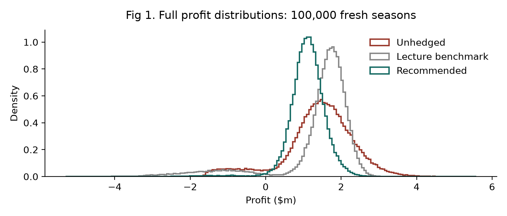
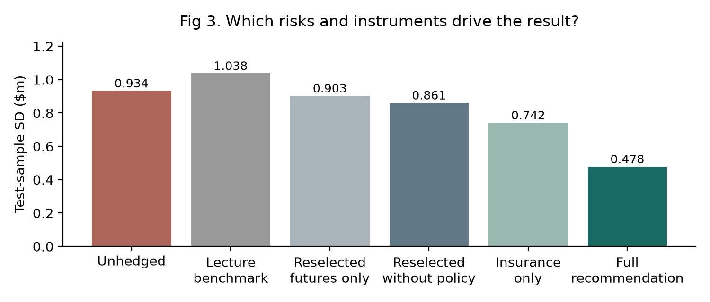
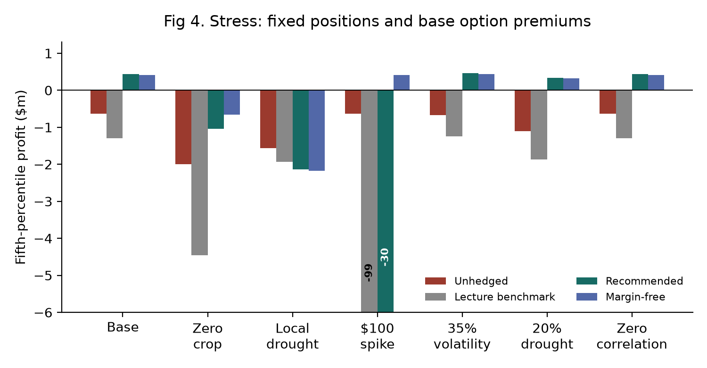
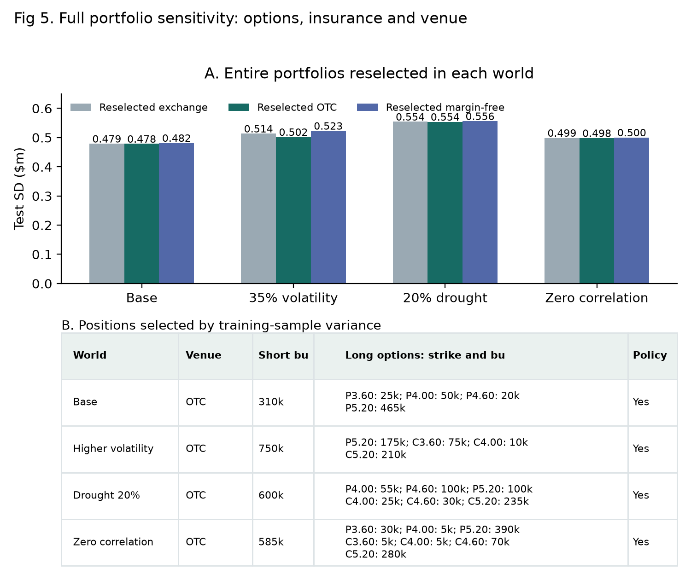

# Project 5 — Farmer Brown: A Variance-Minimising Corn Hedge

[Read the write-up (PDF)](Farmer_Brown_Hedge_hr2917.pdf)

Harsh Raj, Ayush Shah

## Assignment context

A structuring exercise built on the Farmer Brown case from the futures lecture: design a hedging strategy for a corn farmer whose objective is to **minimise the variance of sales proceeds from the harvest**. The case is extended with:

1. volumetric production risk (bushels follow a probability distribution);
2. costs;
3. drought risk;
4. basis risk;
5. margining risk, with a choice between exchange futures and OTC futures that offer a credit line for margin calls at a fee;
6. both options and futures allowed;
7. simulation.

The analysis is limited to one page, excluding graphs. It answers four questions: (a) what assumptions were made, (b) how the analysis was performed, (c) the recommended strategy and how it differed from what was expected, and (d) how it differs from the futures hedge discussed in class.

## Recommendation

Short about **310k bu of OTC July corn futures**, buy **puts, mostly at the $5.20 strike**, and buy **one $3m regional drought policy**. On the test sample, the standard deviation of profit falls from **$0.93m to $0.48m (−73.7% variance)**.

| Test-sample strategy ($m) | SD | Mean profit | 1st pct |
| --- | ---: | ---: | ---: |
| Unhedged | 0.934 | 1.42 | −1.37 |
| Lecture benchmark: short 1m bu exchange futures | 1.038 | 1.40 | −2.59 |
| Selected exchange: 370k futures + puts + policy | 0.479 | 1.13 | −0.49 |
| **Selected OTC: 310k futures + puts + policy** | **0.478** | **1.11** | **−0.52** |
| Margin-free: 855k puts + policy | 0.482 | 1.08 | −0.52 |

OTC put legs (strike: size): $3.60: 25k bu; $4.00: 50k bu; $4.60: 20k bu; $5.20: 465k bu.

## Assumptions (summary)

| Area | Assumption |
| --- | --- |
| Case and costs | 1m bu planned; July CBOT corn at $4/bu; $2m prepaid costs; $5m cash and loans with a $1m reserve, leaving $2m for hedging |
| Price and yield | 25% volatility over 113 trading days (0.45 years). A regional crop-size reveal on a random day 51–113 adds a log price jump N(0.25, 0.08²), compensated so the futures stay a martingale. Normal-year yield has mean 100% and SD 10%, clipped to 60–125%, with −0.3 correlation to price shocks |
| Drought | 8% regional drought, 2% local-only drought; yield U(10%, 50%) in a drought. A $500k regional-index policy pays $3m in a regional drought and with 50% probability in a local one |
| Basis | N(−$0.25, $0.10²) per bu, plus $0.20 in a drought |
| Exchange futures | $0.25/bu margin, $0.005/bu cost, 5% funding; the first margin breach forces a close-out |
| OTC futures | $2m credit line at 1.5%/yr, 8% on draws, then own cash at 5%; $0.01/bu spread |
| Options | Puts and calls at $3.60 / $4.00 / $4.60 / $5.20, priced at expected simulated payoff plus 10%, paid at harvest |
| Limits | Each futures or option leg between 0 and 1m bu, in 5k-bu units |

## Method

- **Simulation.** 100,000 independent seasons for selecting the hedge and a separate 100,000 for testing it (seeds 6103 and 2026). Every result above is out-of-sample.
- **Analytical starting point.** With harvested volume Q and local cash price S = F_T + basis, the minimum-variance futures hedge is `h* = Cov(QS, F_T) / Var(F_T)`. With fixed output and no basis risk this gives the textbook 1m bu.
- **Full search.** A three-start search over all option legs, the futures size, the venue and the policy. It adds daily funding charges and forced liquidation, which the simple formula ignores. The result is an approximate constrained optimum.
- **Robustness.** Stress tests hold the trades fixed under a price spike, higher volatility, more frequent drought and zero correlation. A full reselection reruns the optimisation in each changed world.

## Findings

- **The full short hedge raises risk.** Drought shrinks the crop just as prices jump, so a 1m bu short becomes over-hedged when few bushels are left to sell. Futures alone work best near 305k bu (SD $0.90m).
- **Insurance does much of the work.** On its own, the policy cuts variance by 36.9% at a cost of $0.23m in expected profit. Combined with a smaller short and puts, it brings SD down to $0.48m.
- **OTC rather than exchange.** For the same trades, forced liquidation falls from 1.17% of seasons on the exchange to none OTC. The variance advantage is small ($438 of SD). Expected OTC costs are $18,693 (fee, spread and draw interest), separate from $1.17m of option and policy premiums.
- **If surviving a price spike matters most,** the margin-free hedge (puts plus the policy) has an SD only 0.6% higher and no margin calls at all.
- **Remaining risks:** basis risk, and a local-only drought that the regional policy may not pay out on (5th-percentile profit −$2.13m in that world).






## Files

```text
05-farmer-brown-hedge/
  README.md
  Farmer_Brown_Hedge_hr2917.pdf   submitted one-page analysis with exhibits
  figures/                        exhibits extracted from the PDF
```

The simulation code is not included in this folder.
